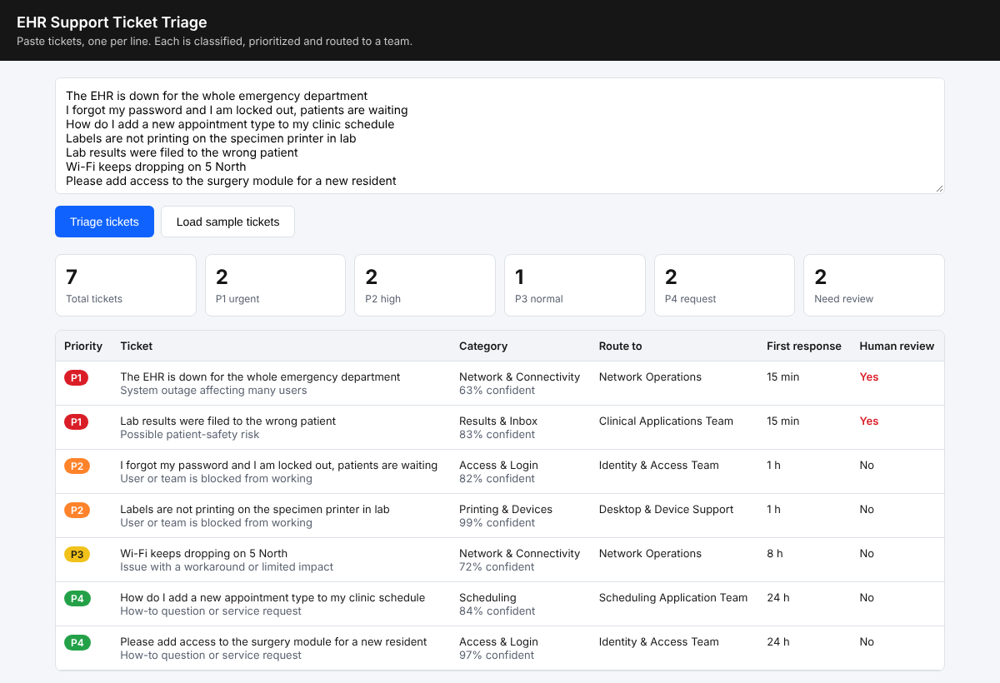
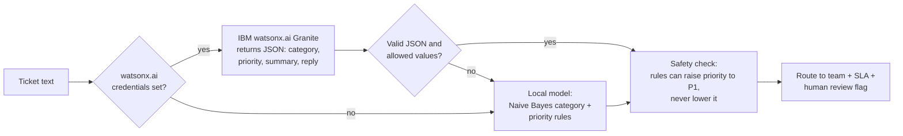

# watsonx Ticket Triage


Automatically **classifies, prioritizes and routes** IT support tickets for a hospital's electronic health record (EHR) system, using **IBM watsonx.ai** with a local machine-learning fallback.



## The business problem

When a hospital goes live on a new EHR, the Service Desk can receive hundreds of tickets a day. Someone has to read each one, decide how urgent it is, and send it to the right team. A patient-safety issue buried in a queue of password resets is a real risk, and manual sorting slows every response.

This tool reads each ticket and, in under a second:
- **Classifies** it into one of 7 categories (Access & Login, Scheduling, Registration, Clinical Documentation, Results & Inbox, Printing & Devices, Network & Connectivity)
- **Sets a priority** from P1 (patient safety or outage) to P4 (how-to or request), with the reason
- **Routes** it to the right team with a first-response target (15 min for P1, up to 24 h for P4)
- **Drafts a first reply** to the user
- **Flags tickets for human review**: every P1, plus any ticket the model is unsure about

**Value for a client:** faster response to urgent issues, less manual sorting, consistent prioritization, and a clear audit trail of why each ticket was ranked.

> I built this from my experience on the Service Desk at NTT DATA and as go-live support for a province-wide Oracle Health (Cerner) EHR rollout at Nova Scotia Health. The 105 tickets in `data/tickets.csv` are realistic examples I wrote, not real tickets.

## How it works



Design choices I made, and why:
- **AI output is validated, never trusted blindly.** If watsonx.ai returns a category or priority that isn't on the allowed list, or invalid JSON, the ticket goes to the local model instead.
- **Safety rules can only raise priority.** If the text mentions a wrong patient, wrong dose, merged records or a hospital-wide outage, it becomes P1 even if the AI said otherwise.
- **Humans stay in the loop.** Every P1 and every low-confidence prediction is flagged for review.
- **It never stops working.** No API key or watsonx.ai outage means the local model takes over.

## Measured accuracy (local model)

Run `python -m app.evaluate` to reproduce. These numbers are for the local fallback model only.

| Measure | Result | How it was tested |
|---|---|---|
| Category | **72%** | 5-fold cross-validation on 105 tickets (chance is 14%) |
| Priority rules, new tickets | **71%** | 35 tickets (T071–T105) the rules were *not* written from |
| Priority rules, original tickets | 100% | The 70 tickets the rules were written from, so not a fair test |

The weakest categories are Access & Login and Network & Connectivity, because their tickets share words like "cannot", "connect" and "session". More training data, or watsonx.ai, would help most here. I report the honest held-out numbers rather than the 100%.

## Tech stack

| Area | Tools |
|---|---|
| AI | IBM watsonx.ai (REST API, IAM authentication), IBM Granite model, JSON output validation |
| Machine learning | Multinomial Naive Bayes written in Python, k-fold cross-validation |
| Back end | Python 3.12, FastAPI, Pydantic |
| Front end | HTML, CSS, JavaScript dashboard |
| Testing | pytest (32 tests), mocked watsonx.ai calls, accuracy thresholds |
| DevOps | Docker, GitHub Actions CI (tests, evaluation and Docker build on every push) |

## Run it locally

```bash
git clone https://github.com/mukhialshifa-max/watsonx-ticket-triage.git
cd watsonx-ticket-triage
python -m venv .venv
source .venv/bin/activate        # Windows: .venv\Scripts\activate
pip install -r requirements-dev.txt
uvicorn app.main:app --reload
```

Open http://localhost:8000/?demo to see the sample tickets triaged, or paste your own.

### Connect IBM watsonx.ai (free trial)

1. Create a free IBM Cloud account and open **watsonx.ai**.
2. Create a project and copy its **Project ID** (*Manage → General*).
3. Associate a **watsonx.ai Runtime** service with the project.
4. Create an **IBM Cloud API key** (*Manage → Access (IAM) → API keys*).
5. Copy `.env.example` to `.env` and fill in `WATSONX_API_KEY` and `WATSONX_PROJECT_ID`. For a Toronto project, set `WATSONX_URL=https://ca-tor.ml.cloud.ibm.com`.
6. Restart the app. The footer shows **Engine: IBM watsonx.ai**.

### Run with Docker

```bash
docker build -t watsonx-ticket-triage .
docker run -p 8080:8080 --env-file .env watsonx-ticket-triage
```

## API

| Method | Path | Description |
|---|---|---|
| `POST` | `/triage` | `{"text": "..."}` returns category, priority, team, SLA, summary, reply, reason |
| `POST` | `/triage/batch` | `{"tickets": ["...", "..."]}` returns results sorted by priority, plus counts |
| `GET` | `/config` | Categories, priorities, routing table and SLA targets |
| `GET` | `/health` | Status and engine in use |
| `GET` | `/docs` | Interactive API docs (Swagger) |

## Project structure

```
app/
  classifier.py     Naive Bayes model and priority rules
  llm.py            watsonx.ai client, prompt, JSON validation
  triage.py         Combines AI + local model, routing, SLA, review flags
  evaluate.py       Accuracy report (cross-validation)
  main.py           FastAPI endpoints
  static/index.html Dashboard
data/tickets.csv    105 labelled sample tickets (15 per category)
tests/              pytest suite
```

## How I built it

I wrote the specification first: the categories and priority levels (based on how service desks I've worked on prioritize), the routing table, the safety rules, and how to measure accuracy fairly. I wrote the sample tickets from situations I've handled. I then used **Claude** as an AI code assistant to generate the code from that spec, and reviewed, tested and evaluated the results.

## Next steps

- Compare watsonx.ai accuracy with the local model on the same 105 tickets
- Connect to a real ticketing tool (ServiceNow or Jira) through its API
- Retrain the local model from analysts' corrections
- Deploy on IBM Cloud Code Engine using the Dockerfile

## Author

**Alshifa Mukhi** · [LinkedIn](https://www.linkedin.com/in/alshifa-mukhi-623909304) · [GitHub](https://github.com/mukhialshifa-max)
